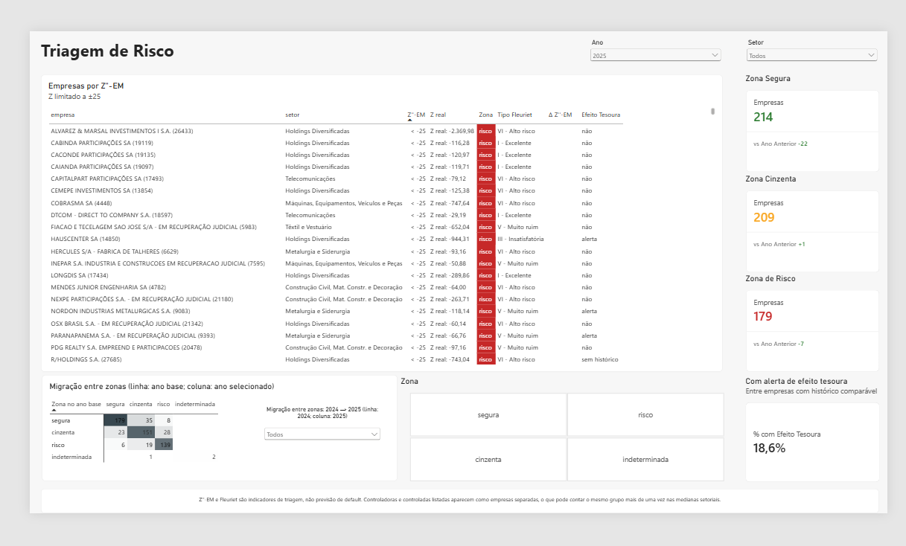
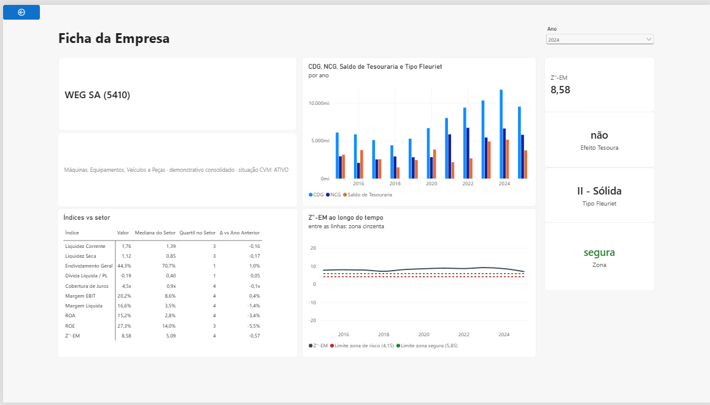
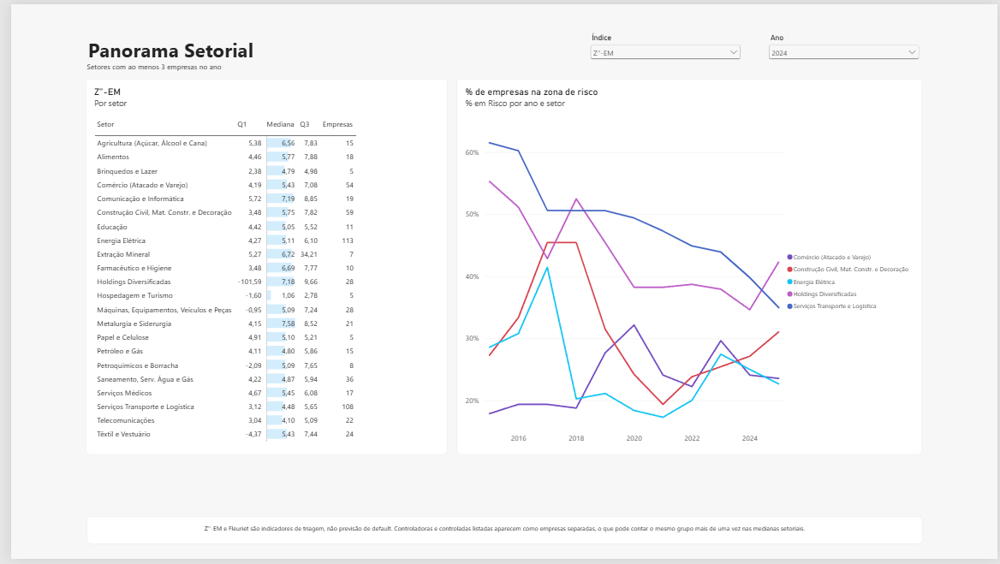
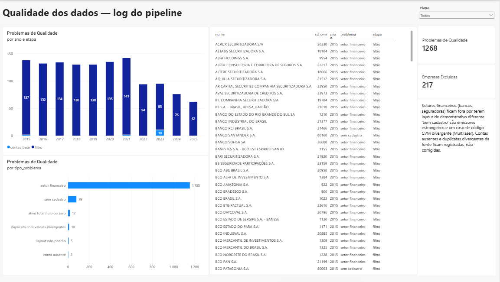

# Análise de crédito de companhias abertas (CVM)

Pipeline em Python que transforma os demonstrativos financeiros públicos da
CVM num modelo estrela, e relatório Power BI de **triagem de risco de crédito**
das companhias abertas brasileiras não financeiras, de 2015 a 2025.

A pergunta do analista de crédito que o relatório responde: *essa empresa
consegue honrar suas obrigações, e está melhorando ou piorando?*

- **830 empresas, 6.266 empresas-ano**, a partir das DFP anuais da CVM.
- **Dois modelos de crédito:** Altman Z''-EM e Modelo Fleuriet (com efeito
  tesoura), além de 9 índices clássicos com benchmark setorial.
- **Números conferidos três vezes:** contra as demonstrações publicadas,
  com testes unitários no pipeline (incluindo as fórmulas do Z e do
  Fleuriet), e os índices e benchmarks calculados em DAX contra o Python em
  todas as 6.266 empresas-ano (0 divergências).



## Os modelos de crédito

### Altman Z''-EM

Versão do Z-score de Altman para mercados emergentes, calculada só com
valores contábeis (não usa valor de mercado):

```
X1 = (Ativo Circulante − Passivo Circulante) / Ativo Total          capital de giro
X2 = (Reservas de Lucros + Lucros Acumulados) / Ativo Total          lucros retidos
X3 = EBIT / Ativo Total                                              rentabilidade operacional
X4 = Patrimônio Líquido / (Passivo Circulante + Não Circulante)      alavancagem

Z''-EM = 3,25 + 6,56·X1 + 3,26·X2 + 6,72·X3 + 1,05·X4
```

| Zona | Faixa | Leitura |
|---|---|---|
| Segura | Z > 5,85 | baixo risco de insolvência |
| Cinzenta | 4,15 ≤ Z ≤ 5,85 | atenção |
| Risco | Z < 4,15 | perfil parecido com o de empresas que quebraram |
| Indeterminada | — | falta componente, ou passivo exigível zero |

**É triagem, não previsão.** O modelo foi calibrado fora do Brasil; aqui ele
serve para ordenar quem olhar primeiro, não para estimar probabilidade de
default.

### Modelo Fleuriet

Lê o balanço pela ótica do capital de giro, separando o que é financiamento
de longo prazo, operação e tesouraria:

```
CDG = (Patrimônio Líquido + Passivo Não Circulante) − Ativo Não Circulante   capital de giro
T   = (Caixa + Aplicações Financeiras) − Empréstimos de Curto Prazo           saldo de tesouraria
NCG = CDG − T                                                                 necessidade de capital de giro
```

| Tipo | CDG | NCG | T | Situação |
|---|---|---|---|---|
| I | + | − | + | Excelente |
| II | + | + | + | Sólida |
| III | + | + | − | Insatisfatória |
| IV | − | + | − | Péssima |
| V | − | − | − | Muito ruim |
| VI | − | − | + | Alto risco |

**Efeito tesoura:** alerta quando, por dois anos seguidos, a NCG cresce mais
que o CDG. A empresa passa a financiar a operação com dívida de curto prazo,
e o saldo de tesouraria afunda. Sem dois anos anteriores comparáveis, o
campo fica **"sem histórico"**. Isso não é ausência de risco, e o relatório
não conta esses casos no denominador da "% com alerta".

## O relatório

| Página | Para quê |
|---|---|
| **Triagem de risco** | Cartões por zona com variação anual, matriz de migração entre zonas (ano base selecionável) e tabela de empresas ordenada pelo Z, com zona, tipo Fleuriet e alerta de tesoura. Clique direito numa empresa → *Detalhamento* abre a ficha. |
| **Ficha da empresa** | Z e zona, 10 índices lado a lado com a mediana e o quartil do setor e a variação anual, Z ao longo do tempo com as faixas das zonas, e CDG/NCG/T por ano. |
| **Panorama setorial** | Q1, mediana e Q3 de qualquer índice por setor, e % de empresas em risco ao longo do tempo. |
| **Qualidade dos dados** | O que o pipeline excluiu ou marcou, e por quê. |

| | |
|---|---|
|  |  |
|  | |

## Arquitetura

```
CVM (ZIP/CSV) → extrair → limpar → filtrar → contas_base → scores → exportar → Parquet → Power BI (PBIP)
```

**Pipeline (`pipeline/`).** Cada etapa é um módulo que recebe e devolve
DataFrames, testável sem rede:

- **Download:** DFP anual de 2015 a 2025 e cadastro da CVM, com cache e 3
  tentativas.
- **Versão:** para cada período, fica a versão mais recente (reapresentação).
- **Valores:** a escala MIL é convertida para reais. Usa o consolidado
  quando existe e o individual como fallback. Entram só contas fixas do
  plano CVM.
- **Exclusões:** instituições financeiras (layout de demonstrativo
  diferente), empresas sem cadastro e empresas com ativo total zero.
- **Log:** cada exclusão ou problema vira uma linha no log de qualidade, e
  não uma exceção.

**Modelo semântico (`powerbi/`, formato PBIP/TMDL).** Estrela com
`fato_indicadores` (uma linha por empresa-ano) ligada a `dim_empresa`,
`dim_ano` e `dim_zona`, e `dim_setor` ligada a `dim_empresa`. Todas as
relações são 1:N com filtro unidirecional. O destaque de DAX:

- **Índices** calculados só no contexto de uma empresa-ano. Um total que
  soma balanços de empresas diferentes não é índice de ninguém.
- **Grupo de cálculo `Benchmark`**: mediana, Q1/Q3, percentil, quartil e
  variação anual do setor, aplicáveis a qualquer índice. Junto com o seletor
  `[Valor do Índice]`, a ficha inteira é uma matriz só.
- **Matriz de migração** entre zonas de dois anos (por padrão, o ano
  anterior), com tabelas desconectadas para o ano base e a zona de origem.
- **Z limitado a ±25 na exibição**: 7% das empresas-ano têm Z extremo por
  ativo irrisório; o Z real continua disponível e é o que define a zona.

Todas as medidas estão explicadas em
[`docs/dicionario-metricas.md`](docs/dicionario-metricas.md).

## Como rodar

**Pré-requisitos:** Python 3.13 e Power BI Desktop (versão com suporte a
PBIP).

```bash
python -m venv .venv
.venv/Scripts/pip install -r requirements.txt       # Windows; em Linux/macOS: .venv/bin/pip
.venv/Scripts/python -m pipeline run                 # baixa 2015–2025 e grava data/processed/*.parquet
```

Opções: `--anos 2020-2025` restringe o período; `--forcar` baixa de novo
arquivos já em cache.

Depois:

1. Abra `powerbi/analise-credito-cvm.pbip` no Power BI Desktop.
2. **Ajuste o parâmetro `PastaDados`** para a sua pasta
   `data\processed\` (*Página Inicial → Transformar dados → Editar
   parâmetros*). O caminho termina em barra invertida.
3. Clique em **Atualizar**.

Testes: `.venv/Scripts/python -m pytest` (82 testes, sem acesso à rede).

## Verificação

| Verificação | Onde | Resultado |
|---|---|---|
| Testes unitários do pipeline e da validação | `tests/` | 82 passam |
| Ativo Total, PL e Lucro Líquido contra as DFP publicadas (WEG, Vale, Ambev, Magazine Luiza, Petrobras) | [`docs/conferencia-dados-reais.md`](docs/conferencia-dados-reais.md) | batem |
| Medidas DAX × Python: índices, Z, zona e tipo Fleuriet em todas as 6.266 empresas-ano; mediana/quartis por setor-ano; percentil; migração de zona | [`docs/validacao-dax.md`](docs/validacao-dax.md) | 0 divergências |
| QA do relatório: interações, detalhamento, totais, formatos, desempenho | checklist de QA | ok |

A comparação DAX × Python é reproduzível: a consulta DAX roda no modelo, o
resultado vai para um CSV, e `python -m pipeline validar-dax <tipo> <csv>`
compara com os índices recalculados pelo Python. Dois defeitos do DAX foram
encontrados assim e estão documentados em `docs/validacao-dax.md`.

## Limitações conhecidas

- **`--anos` parcial sobrescreve as saídas completas.** Rodar `--anos 2024`
  deixa os Parquet só com 2024.
- **Dois exercícios no mesmo ano civil** (troca de data de encerramento,
  cerca de 6 empresas-ano): vale o de fim mais recente, e a DRE pode cobrir
  menos de 12 meses.
- **Dupla contagem nas medianas setoriais:** controladoras (pelo
  consolidado) e controladas listadas aparecem como empresas separadas.
- **Holdings:** o EBIT inclui equivalência patrimonial, e muitas têm receita
  zero. Isso vale para 8,6% das empresas-ano, e nesses casos as margens
  ficam em branco. Os 12,7% com PL ≤ 0 ficam sem ROE e sem Dívida
  Líquida/PL.
- **Z extremo:** 434 empresas-ano têm |Z| > 25, quase sempre empresas sem
  operação. Na exibição aparecem como "< -25" ou "> 25".
- **Cadastro:** a Multilaser ficou de fora porque o CD_CVM da DFP diverge do
  cadastro. Não há fallback por CNPJ. As outras 19 empresas "sem cadastro"
  são emissores estrangeiros.
- **Fora do escopo:** dados trimestrais (ITR), dados de mercado (cotação,
  valor de mercado), EBITDA (a depreciação não é conta fixa), bancos e
  seguradoras, e layout para celular.

## Documentação

- Spec de design: [`docs/superpowers/specs/2026-09-23-analise-credito-cvm-design.md`](docs/superpowers/specs/2026-09-23-analise-credito-cvm-design.md)
- Planos: [pipeline](docs/superpowers/plans/2026-09-23-pipeline-cvm.md) ·
  [relatório Power BI](docs/superpowers/plans/2026-09-23-powerbi-relatorio.md)
- [Dicionário de métricas](docs/dicionario-metricas.md) ·
  [Roteiro de visuais](docs/roteiro-visuais.md) ·
  [Validação DAX × Python](docs/validacao-dax.md) ·
  [Conferência com dados reais](docs/conferencia-dados-reais.md)

Fontes: [Dados Abertos CVM](https://dados.cvm.gov.br/): DFP de companhias
abertas e cadastro.
